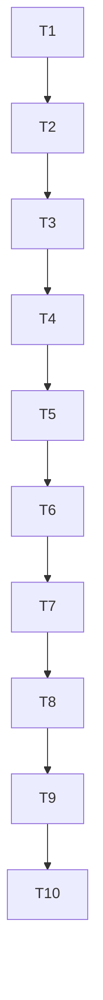

# Integração final

CI pós-merge: [run40007942510](https://github.com/DevDayHackathon/caixa_simples_openAI/actions/runs/40007942510) em andamento na conferência desta continuidade; não declarar aprovação até o resultado final.

## Execution Plan

## Gate Check Commands
quick: npm run test:unit
full: npm run lint && npm run typecheck && npm run test:unit && npm run test:integration
build: npm run check

## Test Coverage Matrix
| Task | Requirement | Tests |
| --- | --- | --- |
| T1 | FINAL-01 | integração SQL real |
| T2 | FINAL-02 | integração sessão/runtime |
| T3 | FINAL-03 | integração decisões e conflitos |
| T4 | FINAL-04 | HTTP áudio e UI/E2E |
| T5 | FINAL-01, FINAL-03 | integração SQL real |
| T6 | FINAL-05 | gate completo e verificador |
| T7 | FINAL-05 | preparo SQL concorrente e gate completo |
| T8 | FINAL-06 | offsets, instantes ambíguos e contexto temporal do modelo |
| T9 | FINAL-05 | isolamento de provedores no E2E |
| T10 | FINAL-07 | recibos finais após avanço de revisão |

## Task Breakdown

### T1: Corrigir persistência do agente
**What**: Migração aplicável, histórico, serialização e integração transacional do encerramento.
**Where**: supabase/migrations/002_tasks.sql, src/features/tasks/supabase-repository.ts, tests/integration/
**Depends on**: None
**Requirement**: FINAL-01
**Tests**: integration
**Gate**: full
**Done when**: SQL real valida aplicar, histórico, tarefas, quota e encerramento. [x]

### T2: Unificar composição e sessão
**What**: Runtime e executor usam FinancePort persistida e cookie financeiro; parâmetros/modelos e versão reais.
**Where**: src/features/agent/, src/features/tasks/server.ts, src/features/finance/session.ts, src/app/api/
**Depends on**: T1
**Requirement**: FINAL-02
**Tests**: integration
**Gate**: full
**Done when**: Sessão real autoriza; falhas não ativam mocks; versão e null do tool testados. [x]

### T3: Persistir decisões e ações do feed
**What**: Propostas e decisões confirmadas com CAS/idempotência, ferramentas de simulação/registro e ações do feed.
**Where**: src/features/agent/, supabase/migrations/003_agent_actions.sql, tests/integration/
**Depends on**: T2
**Requirement**: FINAL-03
**Tests**: integration
**Gate**: full
**Done when**: Aceite, dispensa, ajuste, stale, repetição e resolução têm resultados persistidos. [x]

### T4: Conectar experiência e voz
**What**: Injetar AgentPort no caixa configurado e habilitar voz com autorização e quota compartilhada.
**Where**: src/features/experience/, src/app/api/audio/, tests/e2e/, tests/integration/
**Depends on**: T3
**Requirement**: FINAL-04
**Tests**: integration, e2e
**Gate**: build
**Done when**: Fluxo integrado e falhas de áudio/sessão/quota testados sem chamadas pagas. [x]

### T5: Fechar concorrência e iniciativas
**What**: Cancelar tarefas running, cercar tentativas retomadas e suprimir aceite de iniciativas sem simulação concreta.
**Where**: src/features/tasks/, src/features/agent/actions.ts, supabase/migrations/, tests/integration/
**Depends on**: T4
**Requirement**: FINAL-01, FINAL-03
**Tests**: integration
**Gate**: build
**Done when**: Runner SQL real entrega uma vez, cancelamento suprime aviso, dono expirado é rejeitado e alerta sem parâmetros não oferece aceite. [x]

### T6: Verificar e publicar integração
**What**: Revisão independente/sensor, isolamento E2E por cenário no CI, documentação final, push e merge autorizado com head validado.
**Where**: docs/, .specs/features/integracao-final/, .specs/STATE.md, tests/e2e/finance.spec.ts
**Depends on**: T5
**Requirement**: FINAL-05
**Tests**: integration, e2e
**Gate**: build
**Done when**: Relatório PASS e main remota contém o head revisado; ensaio credenciado pendente identificado. [x]

T1 PASS: lint/tipos,135 unitários,82 integração. FINAL-01: agent-sql.test.ts:11 `toBe('t\nf')`, :16 `toHaveLength(20)`, :24 `toBe('cancelled')`; supabase-tasks.test.ts:59 normaliza metadata/null/data. Mapeamento reverso: novos testes cobrem somente FINAL-01. T1 agrupa migração e adaptador porque o contrato de persistência deve ser verificável junto.

T2 PASS: lint/tipos,135 unitários,85 integração. FINAL-02 agent-composition.test.ts:23 sessão emitida/identidade conservada; :33 source=user_data e version=7; :37 based_on_version=7; :43 produção sem banco lança erro. Reverso: três testes novos cobrem exclusivamente FINAL-02. Legado assinado mantido para compatibilidade; novas sessões usam somente cookie financeiro.

T3 PASS: lint/tipos,135 unitários,91 integração. agent-actions.test.ts:32 `reservations.length=1`/version3/replay, :39 dismissed/zero reservas, :46 stale e sessão estrangeira rejeitadas, :51 data e recibo accepted, :57 simulação -50000 sem escrita, :69 resolução não presume liquidação e leitura/cancelamento persistem. Cada teste novo corresponde FINAL-03; simulação e rascunho não têm envio externo.

T4 PASS: npm run check,135 unitários,95 integração,11 E2E; lint/tipos/build. FINAL-04 audio-live.test.ts:16 HTTP200/texto, :21 bytes MP3 e falha sanitizada, :27 401/429 e zero provedor; agent-integrated.spec.ts:47 proposta sem escrita, :50 reserva persistida50000, :51 recarga/version3 e 360px. Reverso: quatro casos de áudio/status e E2E correspondem somente FINAL-04. Provedor OpenAI local de teste; Postgres real e rotas Next de produção.

T5 PASS: npm run check,135 unitários,99 integração,11 E2E; zero falhas/skips. tasks-sql-runtime.test.ts:25 runner claimed1/completed1/notified1, :26 repetição claimed0, :32 cancelamento devolve createNotification=false, :40 tentativa antiga rejeitada e statusrunning, :43 tentativa atual completed. agent-actions.test.ts:67 alerta negativo não oferece proposta incompleta; :71 simulação concreta accepted sem escrita/version3. Reverso: casos novos correspondem FINAL-01/03 e corrigem achados da revisão independente; nenhuma asserção preexistente alterada.

T6 correção CI: run40005794067 no head21335e6 expôs dependência entre cenários (saldo500 no lugar1000). Reproduzida localmente com finance.spec --workers=1, sem alterar expectativas. beforeEach/afterEach agora isolam banco/servidor por cenário. Gate completo com todos11E2E em1worker PASS (135unit,99integração,11E2E). Nenhuma asserção foi removida/enfraquecida.

T6 publicação concluída: revisão independente PASS e 8/8 mutações detectadas; CI do candidato `4186bdf` aprovado em https://github.com/DevDayHackathon/caixa_simples_openAI/actions/runs/40006622435/job/120599339880. PR3 aprovado e integrado no merge `d3baa174ff488c71f6bb1e9730ad6d89944f3116` em 2026-10-23T19:00:21Z. Protótipo publicado via CLI em https://folego-hackathon-2026.vercel.app (projeto `folego-hackathon-2026`, sem vínculo GitHub), com landing demonstrativa verificada. Evidência de publicação e seus limites em docs/CONTINUAR-SESSAO.md; configuração remota OpenAI/Supabase, migrações/Vault/Cron e UAT U01–U13 permanecem pendentes e não são declarados executados por este fechamento de T6.

### T7: Serializar roles globais do fixture SQL
**What**: Corrigir a corrida entre suítes que criam as mesmas roles do cluster antes de aplicar migrações em bancos isolados.
**Where**: tests/integration/finance/database.ts
**Depends on**: T6
**Requirement**: FINAL-05
**Tests**: integration, e2e
**Gate**: build
**Done when**: Preparo concorrente das roles é serializado na conexão admin comum, gate completo passa sem alterar asserções e revisão independente confirma o caso concorrente. [x]

T7 origem: CI da main consolidada40009173098 falhou em pg_authid_rolname_index ao criar anon; lint/tipos e135unitários PASS, integração98/99; E2E não executado. Trata-se do fixture SQL, não de credenciais ou migração remota.

T7 PASS: lock transacional no banco admin comum; sensor independente reproduziu erro pg_authid no SQL antigo (1/2 processos falha) e ambos passam no novo SQL, com três roles únicas. Roles scratch removidas. npm run check nesta continuidade:135unitários99integrações11E2E, lint/tipos/build PASS, nenhum teste removido/ignorado nem assert alterado. Log local /tmp/folego-continuacao-gate.log; evidência independente em validation.md.

### T8: Corrigir contrato temporal observado na UAT real
**What**: Alinhar validação e schema de ferramenta para instantes ISO com fuso, instruindo o modelo com instante atual e fuso da empresa.
**Where**: src/features/agent/tools.ts, src/features/agent/tools.test.ts, src/features/agent/turn.ts, tests/integration/agent-turn.test.ts
**Depends on**: T7
**Requirement**: FINAL-06
**Tests**: unit, integration, e2e
**Gate**: build
**Done when**: Horário explícito com offset preserva instante UTC e origem user; data sem horário é rejeitada sem escrita; requests do modelo contêm agora/fuso, gate e revisão independente passam. [x]

T8 origem: U08 real recebeu erro genérico e nenhuma tarefa foi criada. Diagnóstico real sanitizado confirmou due_at com offset, explicit_time em formato não completo e commitment_due_at como data sem horário; parser anterior exigia UTCZ enquanto schema do modelo só anunciava string|null.

T8 PASS: tools.test.ts cobre16:26-03:00→19:26Z persistido/sourceuser e6formatosincompletos sem escrita; agent-turn.test.ts verificaagora/fusonasduaschamadas. Sensor independente2/2mutaçõesmortas. Primeirofullgate142/100/10de11FAILporherançaOPENAIrealnofixturefinanceiro; assertpreservado. Gate comOPENAIexplicitamentevazioPASS142unit100integrações11E2E,lint/tipos/build,semfalhas/skips;log/tmp/folego-time-fix-clean-gate.log. Testecontroladodeserviçorealcriou task51e7bb72-23ab-4282-a1b4-5c3f7b8b05d0para19:32Z(16:32SP),sourceuser;U08apósdeployaindapendente.

### T9: Isolar credenciais reais dos fixtures E2E
**What**: Impedir que Next carregue os provedores reais do.envlocal nos cenários financeiro e integrado com Responses simulado.
**Where**: tests/e2e/finance.spec.ts, tests/e2e/agent-integrated.spec.ts
**Depends on**: T8
**Requirement**: FINAL-05
**Tests**: e2e
**Gate**: build
**Done when**: Fixtures sobrescrevem configuração de provedores fora do cenário; npm run check passa sem sanitização externa, sem chamadas pagas e sem alterar asserções. [x]

### T10: Preservar recibo final de proposta na interface
**What**: Corrigir o cartão que mostra reserva aceita como desatualizada após o próprio aceite avançar a versão financeira.
**Where**: src/features/experience/conversation.tsx, src/features/experience/conversation.test.tsx
**Depends on**: T9
**Requirement**: FINAL-07
**Tests**: unit
**Gate**: build
**Done when**: Aceita/dispensada preservam estado final sem controles mesmo com revisão nova; pendentes antigas continuam desatualizadas; gate e revisão independente passam. [ ]

T10 origem: U04real gravou reserva50000/version3 corretamente e devolveuaccepted, mas cartão calculava stale por based_on_version2 antes de considerar estado final.

T9 PASS:2fixtures sobrescrevemenvdeprovedores;assertsintactos. Gate normal npmruncheckPASS142unit100integrações11E2E,lint/tipos/build,semwrapper;log/tmp/folego-fixture-isolation-gate.log. RevisãoindependentePASS;evidênciadiscriminantehistórica:fixtureantigofalhavaaoherdarconfiglocal,novofixturepassacom.envlocalconfigurado. NãosealeganovosensormutacionalT9.
